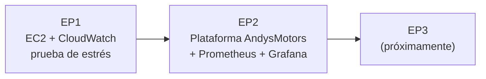

# AndysMotors · Monitoreo y Observabilidad (ADY1103)

Infraestructura y paso a paso de cada evaluación del caso **AndysMotors**, para volver a levantarla en AWS Learner Lab cuando se necesite.



## Evaluaciones

- **[EP1 · Cimientos de observabilidad](ep1/README.md):** EC2 creada con Terraform, prueba de estrés con `stress-ng` y métricas en CloudWatch.
- **[EP2 · Stack Open Source](ep2/README.md):** plataforma AndysMotors del docente en una EC2, tráfico simulado con su script Python, Prometheus, 3 consultas PromQL y 2 dashboards de Grafana como código.

## Requisitos en el PC

- Terraform, AWS CLI y Git.
- Learner Lab iniciado y credenciales copiadas en `~\.aws\credentials`.

## Al volver a una sesión del lab

Al cerrar el lab, las EC2 se **detienen** pero no se borran.

1. Enciéndelas en **EC2 → Instancias → Estado → Iniciar**.
2. La **IP pública cambia**. Para ver la nueva, en la carpeta de la prueba:

```powershell
terraform refresh
terraform output
```

3. Los contenedores (plataforma, Prometheus y Grafana) arrancan solos. El generador de tráfico **no**: vuelve a lanzarlo con el paso 4 del [README de la EP2](ep2/README.md).

## Si se borró todo

Clona este repo y sigue el README de cada prueba desde el paso 1. Con `terraform apply` la infraestructura vuelve a quedar igual.

> No se suben a GitHub los archivos `terraform.tfstate`, `.terraform/` ni las credenciales (ver `.gitignore`).
