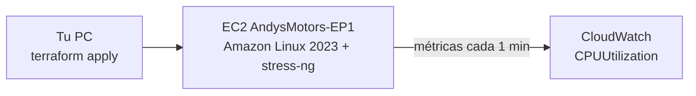

# EP1 · Cimientos de observabilidad

Levanta una EC2 en AWS con Terraform, la somete a una prueba de estrés y muestra cómo CloudWatch registra el aumento de CPU.



## Qué crea

- **Security Group** `andysmotors-ep1-sg`, con el puerto 22 abierto para conectarse por EC2 Instance Connect.
- **EC2** `AndysMotors-EP1` (`t3.micro`, Amazon Linux 2023), con:
  - monitoreo detallado: CloudWatch toma datos cada 1 minuto,
  - `stress-ng` instalado automáticamente al arrancar,
  - el perfil `LabInstanceProfile` del Learner Lab.

## Requisitos

- Terraform y AWS CLI instalados.
- Learner Lab iniciado (**Start Lab**, círculo verde).

---

## 1. Credenciales del Learner Lab

Se repite **cada vez que inicias el lab**, porque las credenciales vencen.

1. En el Learner Lab: **AWS Details → AWS CLI → Show** y copia el bloque `[default]`.
2. Pégalo en tu archivo de credenciales, reemplazando el anterior:

```powershell
notepad $HOME\.aws\credentials
```

3. Comprueba que AWS te reconoce:

```powershell
aws sts get-caller-identity
```

## 2. Levantar la EC2

Desde la carpeta `ep1`:

```powershell
terraform init
```

Descarga el plugin de AWS. Solo hace falta la primera vez.

```powershell
terraform plan
```

Muestra qué se va a crear, sin crear nada. Debe decir `Plan: 2 to add`.

```powershell
terraform apply
```

Crea todo. Escribe `yes` cuando lo pida. Al terminar muestra el `instance_id` y la `ip_publica`.

## 3. Verificar

En la consola de AWS, ve a **EC2 → Instancias**. `AndysMotors-EP1` debe estar **En ejecución** con **3/3 comprobaciones superadas** (tarda unos 2 minutos).

## 4. Prueba de estrés

1. Selecciona la instancia → **Conectar → EC2 Instance Connect → Conectar**.
2. Revisa que `stress-ng` esté instalado:

```bash
stress-ng --version
```

3. Lanza 5 minutos de carga sobre 2 núcleos al 90 %:

```bash
stress-ng --cpu 2 --cpu-load 90 --timeout 300s
```

## 5. Ver el aumento en CloudWatch

1. Ve a **CloudWatch → Métricas → Todas las métricas → EC2 → Métricas por instancia**.
2. Busca el `instance_id` y marca **CPUUtilization**.
3. Ajusta:
   - rango **1 h**,
   - **Zona horaria local**,
   - en **Métricas diagramadas**, período de **1 minuto**.

**Resultado esperado:** CPU cerca de 0 % antes de la prueba y un salto a cerca de 90 % mientras corre `stress-ng`.

## 6. Apagar todo

```powershell
terraform destroy
```

Borra la EC2 y el Security Group. Escribe `yes` para confirmar. Para volver a levantarlos, repite los pasos 1 y 2.
