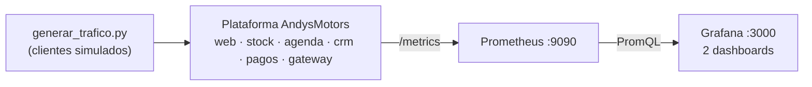

# EP2 · Stack Open Source (Prometheus + Grafana)

Levanta en una EC2 la plataforma de AndysMotors del docente, simula clientes con su script Python y la observa con Prometheus y Grafana.



## Qué contiene esta carpeta

- `main.tf`: EC2 `t3.medium` con Docker instalado y puertos 22, 80, 3000 y 9090.
- `docker-compose.yml`: Prometheus y Grafana, conectados a la red de la plataforma (`demo_andys`).
- `prometheus/prometheus.yml`: targets de las 6 plataformas y de HAProxy.
- `grafana/provisioning/`: datasource y carga automática de dashboards.
- `grafana/dashboards/`: los 2 dashboards en JSON.

---

## 1. Credenciales del Learner Lab

En el Learner Lab: **AWS Details → AWS CLI → Show**. Copia el bloque `[default]` en:

```powershell
notepad $HOME\.aws\credentials
```

## 2. Crear la EC2 (en tu PC)

Desde la carpeta `ep2`:

```powershell
terraform init
terraform apply
```

Escribe `yes`. Anota la `ip_publica` y espera unos 3 minutos a que termine de instalar Docker.

## 3. Levantar la plataforma de AndysMotors (en la EC2)

Conéctate: **EC2 → AndysMotors-EP2 → Conectar → EC2 Instance Connect**.

Descarga el repositorio del docente:

```bash
git clone https://github.com/asanchezo-duoc/ADY1103-Activities.git
cd ADY1103-Activities/Casos/AndysMotors/demo
```

Configura, construye y levanta las aplicaciones:

```bash
cp .env.example .env
sudo docker build -t andys-motors:local ./app
sudo docker compose --profile todo up -d
```

Comprueba en el navegador: `http://IP_PUBLICA` muestra la portada de Andys Motors.

## 4. Simular clientes (en la EC2)

```bash
nohup python3 scripts/generar_trafico.py --url http://localhost --hora-inicio 10 --factor 1 --duracion 86400 > ~/trafico.log 2>&1 &
```

Simula tráfico de horario comercial (10:00) durante 24 horas, en segundo plano.

## 5. Levantar Prometheus y Grafana (en la EC2)

```bash
cd ~
git clone https://github.com/joseyovera/andysmotors-observabilidad.git
cd andysmotors-observabilidad/ep2
sudo docker compose up -d
```

La plataforma (paso 3) debe estar arriba **antes** de este paso, porque Prometheus se conecta a su red `demo_andys`.

## 6. Verificar

- **Prometheus:** `http://IP_PUBLICA:9090/targets`. Los 8 targets deben estar en **UP**.
- **Grafana:** `http://IP_PUBLICA:3000`, usuario `admin` y contraseña `admin` (pide cambiarla). En **Dashboards → AndysMotors** están los dos dashboards, ya conectados a Prometheus.

## 7. Consultas PromQL

Se ejecutan en Prometheus, en la pestaña **Graph**.

**Éxito de negocio:** porcentaje de agendamientos que realmente se guardan.

```promql
100 * sum(rate(agendamientos_confirmados_total[5m]))
    / sum(rate(agendamientos_solicitados_total[5m]))
```

**Disponibilidad:** porcentaje de errores 5xx por plataforma.

```promql
100 * sum by (servicio) (rate(http_requests_total{status_code=~"5.."}[5m]))
    / sum by (servicio) (rate(http_requests_total[5m]))
```

**Latencia:** tiempo bajo el cual responde el 95 % de las peticiones, por plataforma.

```promql
histogram_quantile(0.95,
  sum by (servicio, le) (rate(http_request_duration_seconds_bucket[5m]))
)
```

## 8. Dashboards

**01 Negocio:**

- tasa de confirmación de agendamientos,
- agendamientos solicitados vs confirmados,
- pagos por resultado.

**02 Salud de las plataformas:**

- estado UP/DOWN de cada plataforma,
- errores 5xx por plataforma,
- latencia p95.

Si editas un dashboard en Grafana, expórtalo con **Share → Export → Save to file** y reemplaza su JSON en `grafana/dashboards/`.

## 9. Apagar todo

Desde tu PC, en la carpeta `ep2`:

```powershell
terraform destroy
```
