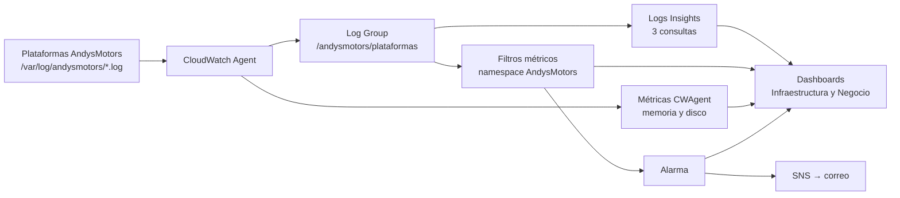

# EP3 · Logs en CloudWatch (ingesta, análisis, alarmas y dashboards)

Centraliza en CloudWatch los logs JSON de las plataformas de AndysMotors, los consulta con Logs Insights, los convierte en métricas y alarmas con aviso por correo, y los muestra junto a la infraestructura en 2 dashboards.



## Qué contiene esta carpeta

- `cloudwatch-agent/config.json`: configuración del agente (6 logs, memoria y disco).
- `main.tf`: 4 filtros métricos, tópico SNS con suscripción por correo y la alarma.
- `dashboards.tf`: dashboards AndysMotors-Infraestructura y AndysMotors-Negocio.
- `bitacora.md`: escenarios de falla activados, con hora de inicio y término.

## Requisito previo

La EC2 de la [EP2](../ep2/README.md) encendida, con la plataforma de AndysMotors corriendo.

---

## 1. Retomar el entorno (en la EC2)

Actualiza el repo del docente y reconstruye, para que las plataformas escriban sus logs en archivos:

```bash
cd ~/ADY1103-Activities && git pull
cd Casos/AndysMotors/demo
sudo docker build -t andys-motors:local ./app
sudo docker compose --profile todo up -d
ls -l /var/log/andysmotors/
```

Deben aparecer 6 archivos: `agenda`, `crm`, `gateway`, `pagos`, `stock` y `web`.

Lanza el tráfico en horario comercial simulado (3 horas):

```bash
nohup python3 scripts/generar_trafico.py --url http://localhost --hora-inicio 9 --factor 1 --duracion 10800 > ~/trafico.log 2>&1 &
```

## 2. Instalar y configurar el CloudWatch Agent (en la EC2)

```bash
sudo dnf install -y amazon-cloudwatch-agent
cd ~/andysmotors-observabilidad && git pull
sudo /opt/aws/amazon-cloudwatch-agent/bin/amazon-cloudwatch-agent-ctl -a fetch-config -m ec2 -s -c file:/home/ec2-user/andysmotors-observabilidad/ep3/cloudwatch-agent/config.json
sudo /opt/aws/amazon-cloudwatch-agent/bin/amazon-cloudwatch-agent-ctl -a status
```

Debe decir `"status": "running"`. En la consola: **CloudWatch → Registros → Administración de registros → `/andysmotors/plataformas`**, con 6 flujos de registro.

## 3. Filtros, alarma, SNS y dashboards (en tu PC)

Crea `terraform.tfvars` en esta carpeta, con el correo de alertas (no se sube a GitHub):

```hcl
email_alertas = "tu_correo@ejemplo.cl"
```

Luego:

```powershell
terraform init
terraform apply
```

Confirma la suscripción desde el correo **"AWS Notification - Subscription Confirmation"**.

Los filtros solo cuentan eventos que llegan **después** de crearlos: este paso va antes de activar las fallas.

## 4. Provocar fallas (en la EC2)

```bash
cd ~/ADY1103-Activities/Casos/AndysMotors/demo
export ANDYS_ADMIN_TOKEN=$(grep ANDYS_ADMIN_TOKEN .env | cut -d= -f2)
./scripts/escenario.sh activar agenda_silenciosa
./scripts/escenario.sh desactivar agenda_silenciosa
```

Escenarios usados: `agenda_silenciosa` y `crm_huerfano` (negocio), y `gateway_lento` (técnico). Las horas quedan en [bitacora.md](bitacora.md).

## 5. Consultas de Logs Insights

En **CloudWatch → Registros → Análisis de registros**, con el grupo `/andysmotors/plataformas`.

**Consulta 1 · Eventos críticos:** advertencias y errores reales, del más reciente al más antiguo.

```
fields @timestamp, servicio, nivel, mensaje, destino, request_id
| filter nivel in ["warn", "error"] and mensaje != "escenario de falla modificado"
| sort @timestamp desc
| limit 50
```

**Consulta 2 · Estadísticas:** latencia promedio y p95 por plataforma, cada 5 minutos.

```
filter mensaje = "peticion atendida"
| stats avg(duracion_ms) as promedio_ms, pct(duracion_ms, 95) as p95_ms by bin(5m) as tramo, servicio
| sort servicio asc, tramo asc
```

**Consulta 3 · Atributos de negocio:** agendamientos perdidos y clientes afectados por sucursal.

```
filter mensaje = "agendamiento descartado sin persistir"
| stats count(*) as agendamientos_perdidos, count_distinct(cliente_nombre) as clientes_afectados by sucursal
| sort agendamientos_perdidos desc
```

## 6. Qué crea Terraform

**Filtros métricos** (namespace `AndysMotors`, valor 1, predeterminado 0):

- `AgendamientosDescartados`: `{ $.mensaje = "agendamiento descartado sin persistir" }`
- `OportunidadesSinCliente`: `{ $.mensaje = "oportunidad creada sin cliente asociado" }`
- `PagosLentos`: `{ $.servicio = "pagos" && $.duracion_ms > 3000 }`
- `ErroresAplicacion`: `{ $.nivel = "error" }`

**Alarma** `AndysMotors-Agenda-Silenciosa`: suma de `AgendamientosDescartados` ≥ 1 en un período de 5 minutos. Los datos faltantes se tratan como no infractores. Avisa por SNS (`andysmotors-alertas`) al entrar en alarma y al volver a OK.

**Dashboards:**

- **AndysMotors-Infraestructura:** CPU, memoria, disco, red y estado de la EC2.
- **AndysMotors-Negocio:** fallas detectadas en los logs, estado de la alarma, latencia p95, agendamientos perdidos por sucursal, últimos eventos críticos y runbook.

## 7. Apagar

Desde tu PC, en esta carpeta:

```powershell
terraform destroy
```

Borra filtros, alarma, SNS y dashboards. El Log Group lo creó el agente: si quieres eliminarlo, hazlo desde la consola.

---

_Desarrollado con apoyo de Claude (Anthropic) como tutor técnico, en modalidad paso a paso. La ejecución, las configuraciones y las validaciones se hicieron en mi propio entorno de AWS Learner Lab._
