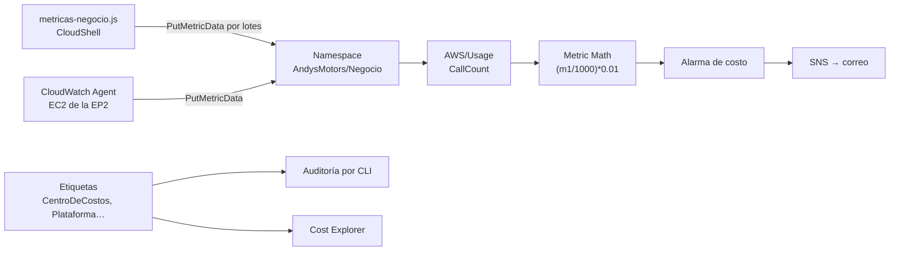

# EP4 · Auditoría FinOps de la observabilidad

Audita cuánto cuesta observar AndysMotors en CloudWatch y cómo controlarlo. Inyecta métricas de negocio con un script sin credenciales, etiqueta los recursos con una taxonomía de costos, audita su cumplimiento, vigila el gasto de la API con una alarma y compara dos diseños en la AWS Pricing Calculator.



## Qué contiene esta carpeta

- `metricas-negocio.js`: envía 3 métricas de negocio a CloudWatch. No tiene credenciales escritas: usa la cadena de credenciales por defecto del entorno.
- `package.json`: dependencia `@aws-sdk/client-cloudwatch`.
- `scp-centro-de-costos.json`: política SCP que impide crear recursos sin la etiqueta `CentroDeCostos`, o con un valor fuera de la lista.

## Requisito previo

La EC2 de la [EP2](../ep2/README.md) encendida y los recursos de la [EP3](../ep3/README.md) creados (agente, alarma, SNS y log group).

---

## 1. Taxonomía de etiquetas

Las claves van en PascalCase. Los valores van sin tildes ni espacios y se eligen de la lista.

- **Entorno:** `Laboratorio`, `Desarrollo` o `Produccion`.
- **Responsable:** `nombre.apellido`.
- **CentroDeCostos:** `TI-Observabilidad`, `TI-Plataformas` o `Comercial`.
- **Proyecto:** `AndysMotors`.
- **Plataforma:** `Agenda`, `CRM`, `Pagos`, `Web`, `Stock` o `Transversal`.

## 2. Métricas de negocio (en CloudShell)

Abre **CloudShell** en la consola y clona el repo:

```bash
git clone https://github.com/joseyovera/andysmotors-observabilidad.git
cd andysmotors-observabilidad/ep4
npm install
node metricas-negocio.js
```

Cada minuto envía en **una sola llamada** las métricas `AgendamientosRegistrados`, `OportunidadesCreadas` y `PagosProcesados`, con la dimensión `Plataforma`. Cada envío debe responder `HTTP 200`.

En la consola: **CloudWatch → Métricas → Métricas clásicas → AndysMotors/Negocio**.

## 3. Etiquetado masivo (en CloudShell)

El **Tag Editor** no está disponible en el Learner Lab (la SCP del laboratorio bloquea Resource Explorer), así que se etiqueta por CLI:

```bash
ACC=$(aws sts get-caller-identity --query Account --output text)

aws resourcegroupstaggingapi tag-resources --region us-east-1 \
  --resource-arn-list \
    arn:aws:ec2:us-east-1:$ACC:instance/<ID_EC2_EP2> \
    arn:aws:cloudwatch:us-east-1:$ACC:alarm:AndysMotors-Agenda-Silenciosa \
    arn:aws:sns:us-east-1:$ACC:andysmotors-alertas \
  --tags Entorno=Laboratorio,Responsable=jose.yovera,CentroDeCostos=TI-Observabilidad,Proyecto=AndysMotors,Plataforma=Transversal
```

La respuesta debe traer `"FailedResourcesMap": {}`.

Los dashboards de CloudWatch **no se pueden etiquetar**: se controlan con la convención de nombre `AndysMotors-*`.

## 4. Auditoría de cumplimiento (en CloudShell)

Lista todos los recursos de la región con el valor de `CentroDeCostos`. Los que muestran `None` no cumplen:

```bash
aws resourcegroupstaggingapi get-resources --region us-east-1 \
  --query "ResourceTagMappingList[].[ResourceARN, Tags[?Key=='CentroDeCostos'].Value | [0]]" \
  --output table
```

Resultado obtenido: 5 de 20 recursos cumplen (25 %). Los que no cumplen son recursos propios del Learner Lab.

## 5. Alarma de costo de la API (en la consola)

En **CloudWatch → Alarmas → Crear alarma → Seleccionar métrica → Uso → Por recurso de AWS**, elige `CallCount` con `Service = CloudWatch`, `Resource = PutMetricData`.

- Estadística **Suma** y período de **5 minutos**.
- Agrega la expresión matemática `(m1/1000)*0.01` (costo en USD), y usa solo esa expresión para la alarma.
- En **Condiciones**: Tipo de límite **Estático**, **Mayor/Igual** que `0.00015`.
- En **Configuración adicional**: tratar los datos que faltan como **Correctos (dentro del límite)**.
- Notificación al tópico `andysmotors-alertas`.
- Nombre: `AndysMotors-FinOps-Costo-API`.

El umbral sale de lo esperado en el diseño optimizado: agente y script hacen 1 llamada por minuto cada uno, es decir, 10 llamadas cada 5 minutos (0,0001 USD), más un 50 % de margen.

**Prueba de desviación:** el modo descontrolado envía cada métrica por separado cada segundo (unas 3 llamadas por segundo):

```bash
MODO=descontrolado node metricas-negocio.js
```

La alarma pasa a **En alarma** en cerca de un minuto y llega el correo de SNS.

## 6. Cost Explorer

En **Administración de facturación y costos → Cost Explorer**:

- **Intervalo de fechas:** el mes en curso. **Nivel de detalle:** Diario.
- **Agrupar por → Dimensión:** Servicio.
- **Más filtros → Tipo de cargo:** solo **Uso**, porque el Learner Lab descuenta los créditos y sin este filtro todo aparece en 0.

En una cuenta real se agrega el filtro **Etiqueta** (`CentroDeCostos` o `Plataforma`). Para eso, antes hay que activar las etiquetas en **Etiquetas de asignación de costos**, opción no disponible en el Learner Lab.

## 7. Escenarios en la AWS Pricing Calculator

Servicio Amazon CloudWatch, región Este de EE. UU. (Norte de Virginia), 30 instancias.

**Escenario A, sin optimizar: 2.435,28 USD/mes.** [Ver estimación](https://calculator.aws/#/estimate?id=8667fc473265e319d4966f5ff980901bdc565fe5)

- 600 métricas (dimensión `InstanceId`, 20 por instancia).
- 155.520.000 llamadas a la API (una métrica por llamada cada 10 segundos).
- 1.350 GB de logs en nivel DEBUG, sin vencimiento.
- 8 dashboards, 25 alarmas estándar y 5 de alta resolución.

**Escenario B, optimizado: 248,78 USD/mes (casi 90 % menos).** [Ver estimación](https://calculator.aws/#/estimate?id=a6efaa4f3f78509abeba8c30a1456897dcd68e7b)

- 100 métricas (dimensión `Plataforma`).
- 1.296.000 llamadas a la API (cada 60 segundos, por lotes).
- 405 GB de logs en nivel INFO, con retención de 30 días.
- 3 dashboards y 15 alarmas estándar.

## 8. Apagar

Detén el script con `Ctrl + C`. La alarma de costo se borra desde **CloudWatch → Alarmas**. Para el resto, sigue el paso **Apagar** de la [EP3](../ep3/README.md#7-apagar) y de la [EP2](../ep2/README.md).

Si más adelante haces `terraform apply` en la EP2 o la EP3, Terraform puede quitar las etiquetas que se pusieron por CLI. Para que no pase, hay que agregarlas en `default_tags` del provider.

---

_Desarrollado con apoyo de Claude (Anthropic) como tutor técnico, en modalidad paso a paso. La ejecución, las configuraciones y las validaciones se hicieron en mi propio entorno de AWS Learner Lab._
